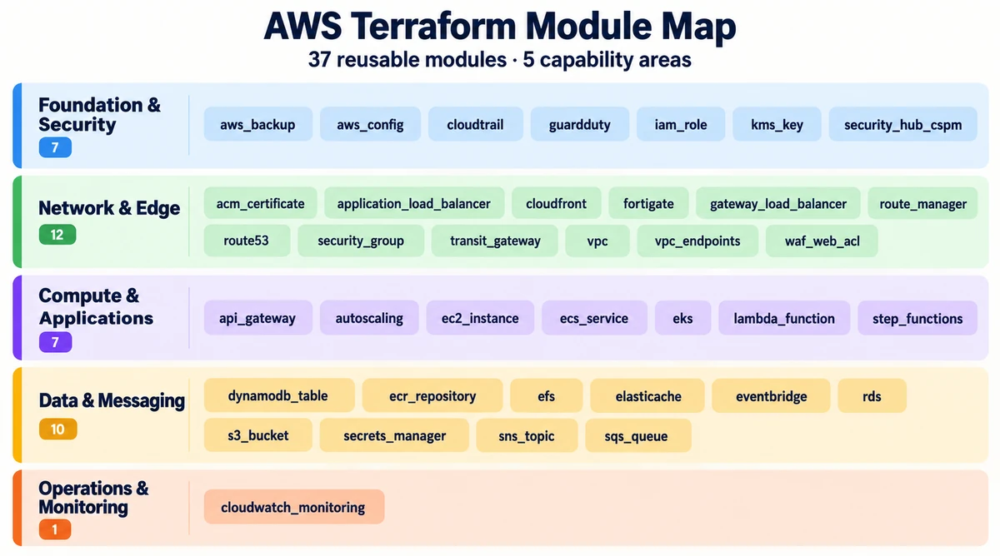

# CCOE AWS Terraform Template

This repository contains reusable Terraform modules for AWS platform and
workload infrastructure, together with the examples, validation tools, and
delivery controls used to maintain them.

## Executive summary

The repository is a module development, validation, and distribution source. It
contains 37 composable modules across foundation and security, network and edge,
compute and applications, data and messaging, and operations. The modules do
not represent one permanently deployed AWS environment.

The `examples/foundation` configuration demonstrates one composition of five
modules: VPC, security group, S3 bucket, IAM role, and EC2 instance. Consumers
can use that composition as a starting point or use individual modules from
their own Terraform root configurations.

| Leadership view | Repository position |
| --- | --- |
| Infrastructure portfolio | 37 reusable AWS modules; browse the [module catalog](#module-catalog) or detailed [Modules Index](docs/20-repository/modules-index.md). |
| Deployment model | Modules are consumed by downstream roots. This repository does not declare one always-on AWS environment or manage a shared deployment backend. |
| Change controls | GitHub Actions formats, lints, scans, validates, runs module tests, and plans the foundation example. Optional publishing follows validation. |
| Security boundaries | Provider credentials, backend configuration, account governance, and state are owned by the consuming root configuration. No AWS apply runs from this template workflow. |
| Operating considerations | AWS Region, service quotas, account setup, KMS key policies, repository variables, and publishing credentials affect which capabilities can be used. |

### Portfolio at a glance

| Capability area | Modules | Scope |
| --- | ---: | --- |
| Foundation & security | 7 | AWS Config, CloudTrail, GuardDuty, AWS Backup, Security Hub CSPM, IAM roles, and KMS keys. |
| Network & edge | 12 | VPCs, Transit Gateway, VPC endpoints, routing, security groups, FortiGate, load balancing, CloudFront, DNS, certificates, and WAF. |
| Compute & applications | 7 | EC2, Auto Scaling, ECS, EKS, Lambda, API Gateway, and Step Functions. |
| Data & messaging | 10 | S3, EFS, RDS, ElastiCache, DynamoDB, Secrets Manager, ECR, SQS, SNS, and EventBridge. |
| Operations & monitoring | 1 | CloudWatch logs, alarms, and dashboards. |

### AWS Terraform module map



**37 reusable modules · five capability areas.** Select any module to open its README.

| Capability area | Modules | Module READMEs |
| --- | ---: | --- |
| 🟦 Foundation & security | 7 | [aws_backup](modules/aws_backup/README.md) · [aws_config](modules/aws_config/README.md) · [cloudtrail](modules/cloudtrail/README.md) · [guardduty](modules/guardduty/README.md) · [iam_role](modules/iam_role/README.md) · [kms_key](modules/kms_key/README.md) · [security_hub_cspm](modules/security_hub_cspm/README.md) |
| 🟩 Network & edge | 12 | [acm_certificate](modules/acm_certificate/README.md) · [application_load_balancer](modules/application_load_balancer/README.md) · [cloudfront](modules/cloudfront/README.md) · [fortigate](modules/fortigate/README.md) · [gateway_load_balancer](modules/gateway_load_balancer/README.md) · [route_manager](modules/route_manager/README.md) · [route53](modules/route53/README.md) · [security_group](modules/security_group/README.md) · [transit_gateway](modules/transit_gateway/README.md) · [vpc](modules/vpc/README.md) · [vpc_endpoints](modules/vpc_endpoints/README.md) · [waf_web_acl](modules/waf_web_acl/README.md) |
| 🟪 Compute & applications | 7 | [api_gateway](modules/api_gateway/README.md) · [autoscaling](modules/autoscaling/README.md) · [ec2_instance](modules/ec2_instance/README.md) · [ecs_service](modules/ecs_service/README.md) · [eks](modules/eks/README.md) · [lambda_function](modules/lambda_function/README.md) · [step_functions](modules/step_functions/README.md) |
| 🟨 Data & messaging | 10 | [dynamodb_table](modules/dynamodb_table/README.md) · [ecr_repository](modules/ecr_repository/README.md) · [efs](modules/efs/README.md) · [elasticache](modules/elasticache/README.md) · [eventbridge](modules/eventbridge/README.md) · [rds](modules/rds/README.md) · [s3_bucket](modules/s3_bucket/README.md) · [secrets_manager](modules/secrets_manager/README.md) · [sns_topic](modules/sns_topic/README.md) · [sqs_queue](modules/sqs_queue/README.md) |
| 🟧 Operations & monitoring | 1 | [cloudwatch_monitoring](modules/cloudwatch_monitoring/README.md) |

### Delivery and control model

1. Contributors update a module, example, test, documentation, or repository
   wiring through a reviewed change.
2. GitHub Actions runs on `main`, `dev`, and `sbx` pushes and pull requests,
   along with manual runs. The Terraform jobs are enabled when the repository
   variable `IS_ORIGIN` is exactly `true`. Azure Pipelines also runs on pushes
   to those three branches.
3. Both pipelines validate Terraform and the foundation example offline, then
   test changed modules in parallel. Shared Terraform, example, or script
   changes select every module. Plans use placeholders without connecting to
   AWS.
4. After validation, the workflow can publish a GitHub stage snapshot and
   synchronize the triggering branch to separate Azure DevOps development and
   production/sandbox repositories.

These are workflow capabilities, not evidence that an AWS environment is
deployed or that a downstream repository accepted a publication. Publishing
depends on the destination path, token, and repository permissions being valid.

## Contents

- [Executive summary](#executive-summary)
- [Portfolio at a glance](#portfolio-at-a-glance)
- [Delivery and control model](#delivery-and-control-model)
- [What is in this repository](#what-is-in-this-repository)
- [Start here](#start-here)
- [Module catalog](#module-catalog)
- [Using a module](#using-a-module)
- [Validation and testing](#validation-and-testing)
- [CI/CD and publishing](#cicd-and-publishing)
- [Secrets and configuration](#secrets-and-configuration)
- [Standards and contributing](#standards-and-contributing)

## What is in this repository

| Path | Purpose |
| --- | --- |
| `modules/` | Reusable AWS Terraform modules. Each module documents its inputs, outputs, security behavior, prerequisites, and limitations. |
| `examples/foundation/` | Five-module example composition for a two-Availability-Zone network and a sample workload. |
| `docs/` | Onboarding, architecture, module usage, contribution, delivery, operations, security, and validation guidance. |
| `scripts/` | Module test and documentation maintenance helpers. |
| `.github/workflows/` | Terraform validation, optional publishing, and documentation portal workflows. |
| `docs-manifest.json` | Generated inventory for the documentation portal. |

Modules do not configure an AWS provider, backend, account credentials, or
Organizations hierarchy. The consuming root owns those settings and supplies
the provider configuration and required inputs.
Terraform `>= 1.6.0` and AWS provider `>= 5.0, < 7.0` are required.

## Start here

| If you want to... | Read first |
| --- | --- |
| Make your first contribution | [First Change Walkthrough](docs/00-start-here/first-change.md) and [Repository Map](docs/00-start-here/repo-map.md) |
| Find guidance by role | [Stakeholder Reading Guide](docs/00-start-here/stakeholder-guide.md) |
| Find a module and its secure defaults | [Modules Index](docs/20-repository/modules-index.md) |
| Understand composition order and cross-module dependencies | [Module Usage and Dependencies](docs/20-repository/module-usage-and-dependencies.md) |
| Understand repository boundaries and module ownership | [Repository Architecture](docs/10-architecture/repository-architecture.md) |
| See a working module composition | [Foundation example](examples/foundation/README.md) |
| Add or maintain a module | [Add or Update a Module](docs/30-deployment/add-or-update-module.md) and [Terraform Module Standard](docs/60-security-governance/terraform-module-standard.md) |
| Understand GitHub workflow triggers and publishing settings | [GitHub Actions pipeline](docs/40-pipelines/github-actions-pipeline.md) |
| Understand Azure DevOps push validation | [Azure DevOps pipeline](docs/40-pipelines/azure-devops-pipeline.md) |
| Understand branch validation and consumer deployment boundaries | [Environment and Delivery Lifecycle](docs/30-deployment/environment-lifecycle.md) |
| Respond to a pipeline or Terraform incident | [Operations Handbook](docs/50-operations/operations-handbook.md) |
| Understand consumer state, recovery, deletion, and cost ownership | [State and Recovery](docs/50-operations/terraform-state-and-recovery.md), [Resource Removal](docs/50-operations/destroy-a-resource.md), and [Cost and Budget](docs/50-operations/cost-and-budget-guide.md) |
| Review validation commands and limits | [Validation Summary](docs/70-validation/validation-summary.md) |
| Apply resource naming and tagging conventions | [Naming Convention](docs/60-security-governance/naming-convention.md) and [Tagging Standard](docs/60-security-governance/tagging-standard.md) |

For a first contribution, review the relevant module README, its tests and any
checked-in examples, then check the module documentation and engineering
standards.

## Module catalog

The module directories are the canonical entry points; each links to its own
README and copyable usage example.

### Foundation & security

[`aws_backup`](modules/aws_backup) · [`aws_config`](modules/aws_config) ·
[`cloudtrail`](modules/cloudtrail) · [`guardduty`](modules/guardduty) ·
[`iam_role`](modules/iam_role) · [`kms_key`](modules/kms_key) ·
[`security_hub_cspm`](modules/security_hub_cspm)

### Network & edge

[`acm_certificate`](modules/acm_certificate) ·
[`application_load_balancer`](modules/application_load_balancer) ·
[`cloudfront`](modules/cloudfront) ·
[`fortigate`](modules/fortigate) ·
[`gateway_load_balancer`](modules/gateway_load_balancer) ·
[`route_manager`](modules/route_manager) · [`route53`](modules/route53) ·
[`security_group`](modules/security_group) ·
[`transit_gateway`](modules/transit_gateway) · [`vpc`](modules/vpc) ·
[`vpc_endpoints`](modules/vpc_endpoints) · [`waf_web_acl`](modules/waf_web_acl)

### Compute & applications

[`api_gateway`](modules/api_gateway) ·
[`autoscaling`](modules/autoscaling) ·
[`ec2_instance`](modules/ec2_instance) ·
[`ecs_service`](modules/ecs_service) ·
[`eks`](modules/eks) ·
[`lambda_function`](modules/lambda_function) ·
[`step_functions`](modules/step_functions)

### Data & messaging

[`dynamodb_table`](modules/dynamodb_table) ·
[`ecr_repository`](modules/ecr_repository) ·
[`efs`](modules/efs) · [`elasticache`](modules/elasticache) ·
[`eventbridge`](modules/eventbridge) · [`rds`](modules/rds) ·
[`s3_bucket`](modules/s3_bucket) ·
[`secrets_manager`](modules/secrets_manager) ·
[`sns_topic`](modules/sns_topic) · [`sqs_queue`](modules/sqs_queue)

### Operations & monitoring

[`cloudwatch_monitoring`](modules/cloudwatch_monitoring)

The [Modules Index](docs/20-repository/modules-index.md) lists the primary
resources and important secure defaults for each module. Focused cross-module
guidance is in [Module Usage and Dependencies](docs/20-repository/module-usage-and-dependencies.md).

## Using a module

Use a module from a Terraform root that configures the AWS provider and backend.
The root passes the provider and required module inputs:

```hcl
module "network" {
  source = "./modules/vpc"

  # Set the module's required inputs for your account and Region.
}
```

For a complete example with concrete inputs, see
[`examples/foundation`](examples/foundation). Read a module's prerequisites
before use; some services require account-level enablement, service-linked
roles, explicit KMS key policies, or preexisting networking.

## Validation and testing

Run repository checks from the root:

```powershell
terraform fmt -check -recursive
tflint --init
tflint --recursive --format compact
./scripts/Test-TerraformModules.ps1
./scripts/Update-ModuleDocs.ps1
```

The module test script initializes, validates, and runs Terraform tests for the
module catalog. Module tests use mocked providers and do not create AWS
resources. The foundation example can be initialized and planned without an
AWS API connection; see its README for the command and required placeholder
input.

Live plans, applies, and integration testing should be performed by the
consuming root under its own backend, credential, and approval controls.

## CI/CD and publishing

`.github/workflows/terraform.yml` provides:

- workflow lint, Terraform formatting, TFLint, and Trivy IaC/secret scanning;
- a repository gate controlled by `IS_ORIGIN`;
- backend-free validation and planning for the foundation example;
- changed-module targeting and validation;
- optional release tags when `ENABLE_GITHUB_RELEASE_TAG` is exactly `true`;
- optional publishing to a GitHub stage repository; and
- optional synchronization to separate Azure DevOps development and
  production/sandbox repositories.

Pull requests do not publish downstream repositories. The ADO jobs
force-update the matching `main`, `dev`, or `sbx` branch and an optional release
tag after the required validation jobs complete. Protect the destinations
accordingly.
The workflow does not apply AWS resources.

The native [`azure-pipelines.yml`](azure-pipelines.yml) pipeline provides
Terraform formatting and foundation validation, an offline foundation plan,
and changed-module detection followed by validation/tests in a parallel matrix
capped at four jobs. Shared Terraform, example, and script changes select all
modules; documentation-only changes select none. It uses placeholder AWS
credentials and does not configure a remote backend or apply AWS resources. It
runs on `main`, `dev`, and `sbx` pushes; pull request validation remains in
GitHub Actions.

The separate [documentation portal workflow](.github/workflows/pages.yml)
builds the Markdown catalog for GitHub Pages.

See the [GitHub Actions pipeline guide](docs/40-pipelines/github-actions-pipeline.md)
for the full job flow, required settings, and troubleshooting guidance. The
Azure DevOps pipeline does not require AWS or Azure service connections.

## Secrets and configuration

Never commit credentials, backend secrets, Terraform state, or secret values.
The consuming Terraform root supplies AWS credentials and backend configuration.

GitHub Actions settings for optional publishing include:

| Setting | Type | Purpose |
| --- | --- | --- |
| `IS_ORIGIN` | Repository variable | Must be exactly `true` to enable downstream Terraform workflow jobs. |
| `ENABLE_IAC_SECRET_SCAN` | Repository variable | The security scan stays enabled unless this value is exactly `false`. |
| `ENABLE_GITHUB_RELEASE_TAG` | Repository variable | Enables release-tag creation when exactly `true`. |
| `STAGE_REPOSITORY` | Repository variable | GitHub stage destination in `owner/repository` form. |
| `STAGE_REPO_TOKEN` | Secret | Token scoped to the GitHub stage destination. |
| `ADO_DEV_REPOSITORY` | Repository variable | ADO development destination in `organization/project/_git/repository` form. |
| `ADO_DEV_REPO_PAT` | Secret | Token with access to push branches and tags to the ADO development destination. |
| `PUBLISH_ADO_PROD` | Repository variable | Must be exactly `true` to enable the production/sandbox publisher. |
| `ADO_PROD_REPOSITORY` | Repository variable | ADO destination in `organization/project/_git/repository` form. |
| `ADO_PROD_REPO_PAT` | Secret | Token with access to push branches and tags to the ADO destination. Keep it at repository or organization scope because preflight is not attached to the `prod` environment. |

`ADO_DEV_REPOSITORY` and `ADO_DEV_REPO_PAT` configure the separate ADO Dev
publisher. Both ADO publishers use repository or organization secrets because
preflight has no environment assigned.

## Standards and contributing

- [Repository Architecture](docs/10-architecture/repository-architecture.md)
- [Platform Operating Model](docs/10-architecture/platform-operating-model.md)
- [Architecture Decision Records](docs/10-architecture/architecture-decision-records.md)
- [VPC Endpoints and Private DNS](docs/10-architecture/vpc-endpoints-and-private-dns.md)
- [Module Documentation Standard](docs/20-repository/module-documentation-standard.md)
- [Foundation Composition Guide](docs/20-repository/foundation-composition-guide.md)
- [Add or Update an AWS Module](docs/30-deployment/add-or-update-module.md)
- [Azure DevOps Pipeline](docs/40-pipelines/azure-devops-pipeline.md)
- [Module State and Lifecycle Ownership](docs/50-operations/module-state-and-lifecycle.md)
- [Cost and Budget Guide](docs/50-operations/cost-and-budget-guide.md)
- [Terraform State and Recovery](docs/50-operations/terraform-state-and-recovery.md)
- [Operations Handbook](docs/50-operations/operations-handbook.md)
- [Remove a Terraform-Managed Resource](docs/50-operations/destroy-a-resource.md)
- [Terraform Module Standard](docs/60-security-governance/terraform-module-standard.md)
- [Code Standards](docs/60-security-governance/code-standards.md)
- [DevSecOps and GitOps](docs/60-security-governance/devsecops-gitops.md)
- [AWS Identity and Access](docs/60-security-governance/aws-identity-and-access.md)
- [Pre-commit Setup](docs/60-security-governance/pre-commit-setup.md)
- [Naming Convention](docs/60-security-governance/naming-convention.md)
- [Tagging Standard](docs/60-security-governance/tagging-standard.md)
- [Modules Index](docs/20-repository/modules-index.md)
- [Module Usage and Dependencies](docs/20-repository/module-usage-and-dependencies.md)
- [GitHub Actions pipeline](docs/40-pipelines/github-actions-pipeline.md)
- [Validation Summary](docs/70-validation/validation-summary.md)

Before opening a pull request, update the module README, examples, tests, and
focused docs as needed; run formatting, lint, and module validation; and review
the workflow results before using any module against a live AWS account.
