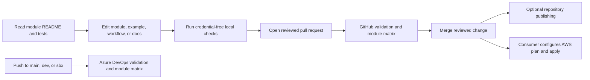

# Repository Map and Glossary

This guide explains what the AWS template contains, where common work belongs, and how a change moves through its validation workflows.

## What this repository is

This is a reusable catalog of AWS Terraform modules, with mocked tests and an example composition. It is not a deployed AWS environment or a consumer's stateful deployment root. A consumer can use a module independently or compose several modules in its own root configuration.

## Folder map

| Path | Purpose |
| --- | --- |
| `modules/<name>/` | Reusable capability, Terraform source, mocked tests, and module README. |
| `examples/foundation/` | Example composition of VPC, security group, S3 bucket, IAM role, and EC2 instance. |
| `docs/` | Architecture, module use, contribution, pipeline, operations, security, and validation guidance. |
| `.github/workflows/terraform.yml` | GitHub Actions validation and optional repository publishing. |
| `azure-pipelines.yml` | Azure DevOps push validation and changed-module test matrix. |
| `scripts/` | Module test, target detection, documentation, and pipeline helpers. |
| `docs-manifest.json` | Inventory consumed by the documentation portal. |

Start with the [Modules Index](../20-repository/modules-index.md), then read a module's README, tests, and relevant examples before changing it.

## A change through the repository

Workflow configuration describes available checks and gates. Actual publication depends on repository settings, credentials, permissions, and destination configuration. A green validation run does not prove AWS resources are deployed or healthy.

## Glossary

| Term | Meaning |
| --- | --- |
| **Terraform module** | Reusable infrastructure configuration with inputs and outputs. |
| **Consuming root** | The Terraform configuration that selects modules and owns provider configuration, credentials, account/Region, backend, and lifecycle. |
| **Provider** | Terraform's connection to an API such as AWS. The calling root configures provider instances and authentication. |
| **Backend** | The storage and locking system used for shared Terraform state. This repository's example uses no remote backend. |
| **State** | Terraform's record of managed resources. It may contain sensitive infrastructure data. |
| **Plan** | A preview of proposed Terraform changes. Review it before applying. |
| **Apply** | The operation that changes the target environment according to a plan. |
| **Environment** | A separately governed consumer deployment target, such as development, sandbox, or production. Branch names in this repository do not create AWS environments. |
| **PAT** | A personal access token used for an optional Azure DevOps destination. Never store token values in source files. |
| **PR** | A pull request: a reviewable proposal to merge a change into a branch. |

## Where to go next

- [First Change Walkthrough](first-change.md)
- [Stakeholder Reading Guide](stakeholder-guide.md)
- [Repository Architecture](../10-architecture/repository-architecture.md)
- [Environment and Delivery Lifecycle](../30-deployment/environment-lifecycle.md)
- [Terraform State and Recovery](../50-operations/terraform-state-and-recovery.md)
