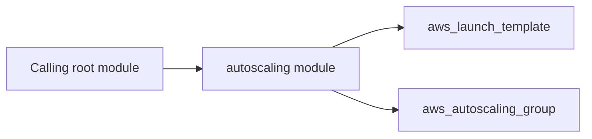

# Auto Scaling Architecture

The autoscaling module declares 2 managed resource type(s), including `aws_launch_template`, `aws_autoscaling_group`.

The module accepts 22 input(s), with 6 required.
It returns 4 output(s), including `autoscaling_group_name`, `autoscaling_group_arn`, `launch_template_id`, `launch_template_latest_version`. Pass these to downstream modules instead of recreating the resources in the caller.

The caller owns the surrounding infrastructure, such as the resource group, networks, identities, and key or log destinations that this module references. See the [module README](../README.md) for inputs and usage.
