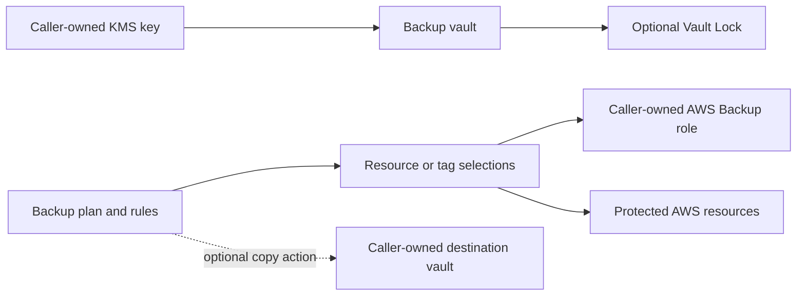

# AWS Backup Module Architecture

The module creates an encrypted Backup vault and plan, attaches the declared selections to the plan, and optionally configures Vault Lock. It expects KMS encryption and the service roles or target vaults to be supplied by the caller.

## Resource relationships

Rules control schedule, lifecycle, continuous backup, and optional copy actions. Selections use explicit resource ARNs or tag conditions. The caller creates a least-privilege role trusted by AWS Backup and establishes destination-vault policy and KMS access for copies.

## Retention and deletion

The default daily rule retains recovery points for 35 days. Vault Lock can enforce retention and, in compliance mode, may become irreversible after its change window. Review minimum and maximum retention, copy destinations, legal requirements, and recovery tests before enabling it.

Vault deletion is not a routine cleanup step. Force deletion is disabled by default and production guardrails prohibit it; recovery points and retention obligations must be resolved by an approved process. The module does not prove that backups are restorable or that protected resources match the intended recovery policy.
