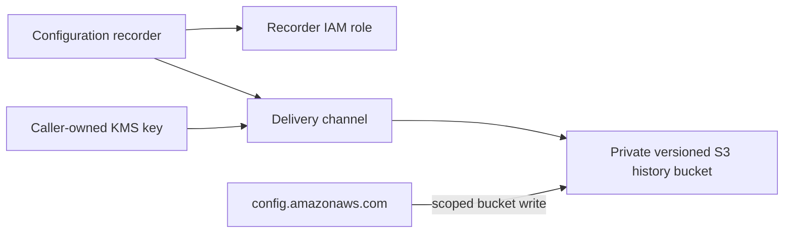

# AWS Config Module Architecture

The module configures one regional AWS Config recorder and delivery channel, an IAM recorder role, and a dedicated S3 history bucket. The caller supplies a same-Region symmetric KMS key and owns organization-wide Config governance.

## Resource relationships

The recorder role receives AWS Config read permissions and bucket-scoped write access. S3 public access is blocked, encryption and versioning are enabled, and bucket access requires TLS. The supplied key policy must allow the Config service to encrypt delivery for the account and Region.

## Regional and organization scope

AWS Config allows one recorder and delivery channel per account and Region; this module manages those default-named resources as a unit. Continuous recording and broad supported resource coverage are defaults. Global resource types are opt-in and should normally be recorded in a designated Region to avoid duplicates.

The bucket retains history and cannot be deleted while it contains objects. Config rules, aggregators, organization delegation, cross-account collection, and notifications are not created by this module. Review recording coverage, key policy, retention, and Config/S3 charges with the governance owner.
