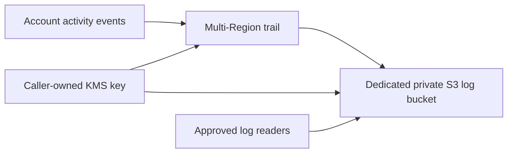

# CloudTrail Module Architecture

The module creates a multi-Region CloudTrail trail and a dedicated S3 bucket for trail log delivery. The caller supplies a KMS key and owns any downstream analytics, alerting, organization delegation, and log consumers.

## Resource relationships

The bucket is configured with public-access blocks, encryption, versioning, TLS-only access, and a CloudTrail service write policy. The key policy must allow CloudTrail to encrypt delivery and approved principals to decrypt logs. The dedicated bucket retains objects unless a lifecycle rule is added separately.

## Scope and operations

The default trail records management events across Regions and global service events. Data events and Insights are not enabled by this module and can materially increase volume and cost. Organization trail mode requires deployment from an appropriately delegated Organizations account; organization membership and delegation are external responsibilities. CloudWatch Logs delivery, alert rules, and retention/lifecycle policy are not created here.

Protect the logs and key as security evidence. Review access, retention, region coverage, event selectors, and KMS policy before deployment. Removing a non-empty bucket is blocked because force deletion is disabled.
