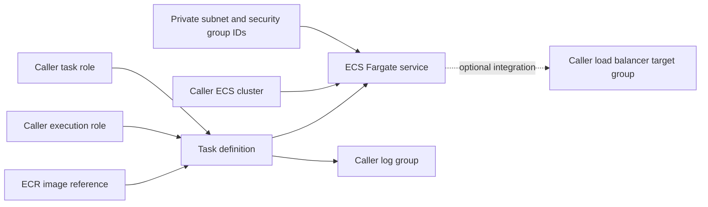

# ECS Service Module Architecture

The module creates a Fargate task definition and ECS service on an existing cluster. Cluster capacity, IAM roles, networking policy, load balancer, image publishing, log groups, and secret values are owned by the caller or separate modules.

## Resource relationships

The service uses private subnets and does not assign public task IPs. The deployment circuit breaker is required, and production guardrails require at least two tasks. Container definitions should reference Secrets Manager or Parameter Store values instead of embedding plaintext secrets.

## Caller responsibilities

Create the ECS cluster, task execution and application roles, security groups, private egress or VPC endpoints, image, log group, and any load balancer target group. Ensure task-role permissions are limited to the application and execution-role permissions cover image pulls, logs, and secret retrieval. The module does not verify that the image exists, that the application is healthy, or that a target group is reachable.
