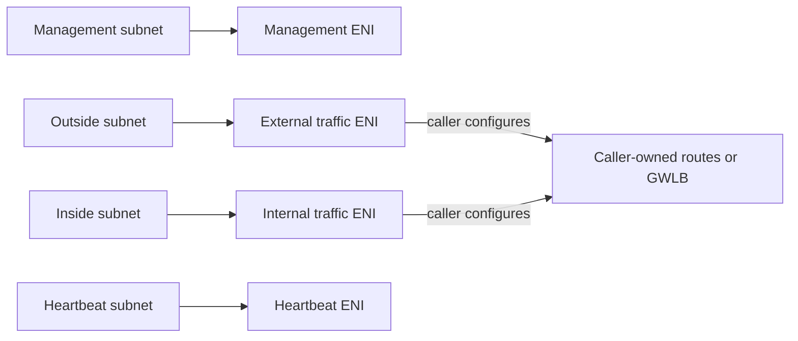

# FortiGate Module Architecture

The module manages FortiGate EC2 instances and additional network interfaces. The calling composition owns the VPC, subnets, security groups, AMI approval, licensing subscription, route tables, and any load-balancing or endpoint resources.

## Interface model

The exact interface roles and device indexes are declared in the module input map. Additional ENIs are attached to the instance, and their private addresses are exposed for downstream routing or target registration. In active-passive mode, the module creates two nodes and generates the configured FortiOS HA bootstrap stanza; the surrounding network and failover integration must be designed separately.

## Bootstrap, access, and lifecycle

The AMI is explicitly selected or resolved using configured filters. BYOL/PAYG metadata does not enroll an account in AWS Marketplace or verify entitlement. Bootstrap user data can include FortiOS commands and, for BYOL, license data; user data is stored in Terraform state, so protect and review that input accordingly.

Public IP assignment is disabled unless explicitly allowed and is rejected by production guardrails. Prefer a controlled management path and restricted security groups. Interface role, key, or device-index changes can replace or reattach networking and interrupt traffic. Validate AMI/FortiOS compatibility and HA behavior in a dedicated sandbox before production use.
