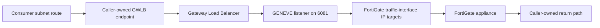

# Gateway Load Balancer Module Architecture

This module provides the GWLB, GENEVE target group, listener, and IP target registrations used for inline appliance inspection. It does not create FortiGate instances, endpoint services, GWLB endpoints, security groups, or traffic-steering routes.

## Traffic insertion

Register traffic-interface IPs, not management or heartbeat interfaces. Every enabled GWLB Availability Zone needs a target in that zone. FortiGate must have a compatible GENEVE interface and respond to the configured health check. Cross-zone load balancing, deletion protection, and a health-check configuration are represented in the module inputs/defaults; coordinate changes with the appliance HA design.

## Composition and limits

Compose this module with FortiGate and the caller's endpoint service, endpoints, and route-table changes. The GWLB existing by itself does not steer workload traffic. Validate forward and return paths, zonal coverage, health checks, and failover behavior in a sandbox. Target changes can deregister and re-register addresses; route and endpoint changes can interrupt flows. Review GWLB, endpoint, and data-processing costs for the intended Region.
