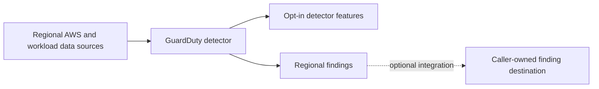

# GuardDuty Module Architecture

The module enables a GuardDuty detector and optional protection features in one account and the configured Region. Organization membership, delegated administration, finding delivery, and response automation belong to a separate security composition.

## Resource relationships

The detector is enabled by default. Features are opt-in and keyed by AWS feature name; available features and prerequisites vary by Region and workload. Some protection plans require supporting agents, add-ons, or service-linked roles. The module does not create those dependencies unless explicitly listed in its resource scope.

## Organization and response boundaries

The detector and feature resources are regional. Enabling or removing a detector has account-wide effects within that Region, and destroying it removes existing findings. Feature cost depends on analyzed data, events, and workloads; estimate and monitor before enabling additional plans.

Use an organization/security root to manage delegated administration, account auto-enrollment, cross-account findings, Security Hub integration, and incident response. Review the GuardDuty findings path end to end before relying on the detector as an operational control.
