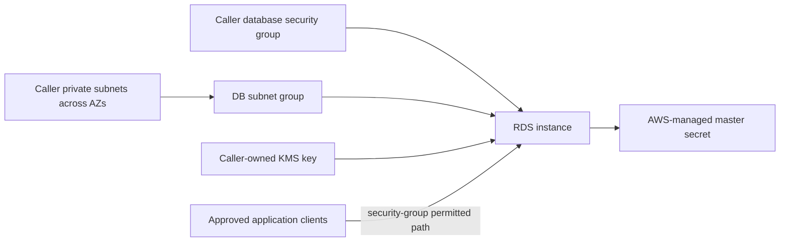

# RDS Module Architecture

The module creates one encrypted RDS DB instance and a DB subnet group from caller-provided private subnet IDs. Network policy, the VPC, security groups, and KMS key remain external dependencies.

## Resource relationships

The module defaults to private networking, encryption, Multi-AZ deployment, automated backups, deletion protection, minor-version upgrades, and a final snapshot. The master password is managed by RDS and stored in Secrets Manager; the module intentionally accepts no plaintext password input. Production guardrails prevent weakening key recovery controls.

## Operational boundaries

Select engine version, instance class, parameter behavior, log exports, backup retention, and subnet/AZ coverage for the target Region. Restrict inbound database access through the caller-owned security group. Engine upgrades, class changes, subnet changes, and storage options can require downtime or replacement; review the plan and RDS maintenance behavior before applying.

The module does not provision database schemas, users beyond the managed master account, application connectivity, read replicas, or cross-Region disaster recovery. Test restore and failover procedures in the consuming environment.
