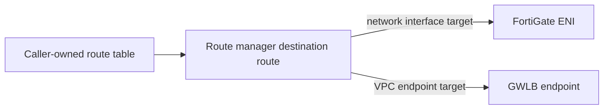

# Route Manager Module Architecture

The route manager owns the VPC route objects declared in its inputs. It does not own route tables, subnet associations, next-hop resources, or the monitoring that decides whether a path is healthy.

## Route ownership

Each declared route identifies a route table, destination, and explicit target type and ID. The module can choose between a primary and secondary target using `active_target`; that is a configuration-driven Terraform change, not an in-service health check.

## Safe composition

Assign one Terraform owner to each route-table/destination pair. Confirm that the selected next hop is valid and reachable in the target VPC, and plan a tested rollback path before changing a live traffic route. A separate automation service and this module must not manage the same route object concurrently.

The module does not create VPC routes for Transit Gateway attachments or manage Transit Gateway propagation; use the Transit Gateway module and caller-owned subnet route tables for those paths. Route changes can interrupt traffic even when the Terraform apply succeeds.
