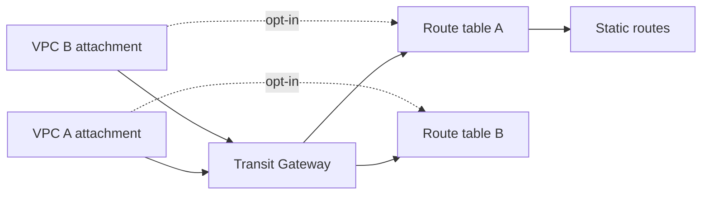

# Transit Gateway Module Architecture

The module creates a Transit Gateway, VPC attachments, Transit Gateway route tables, explicit associations, optional propagation, and static IPv4/IPv6 routes. VPC subnet route tables and external network connectivity remain caller-owned.

## Resource relationships

Each attachment maps to one declared Transit Gateway route table. Propagation is separately declared per attachment and route table; it is not enabled implicitly. Static routes refer to attachment keys so route targets follow the composition's named attachments.

## Composition and ownership

Create a subnet in each Availability Zone that should carry traffic for each VPC attachment. Add routes in the attached VPC subnet route tables that send intended destinations to the Transit Gateway. Review both directions of the path and ensure VPC CIDRs do not overlap.

The module does not create VPC subnet routes, share the Transit Gateway with AWS RAM, accept cross-account attachments, or configure VPN, Direct Connect, peering, Connect, or multicast. Changes to associations, propagation, and routes can interrupt traffic; roll them out against a tested connectivity plan. Attachment hours and data processing incur charges.
