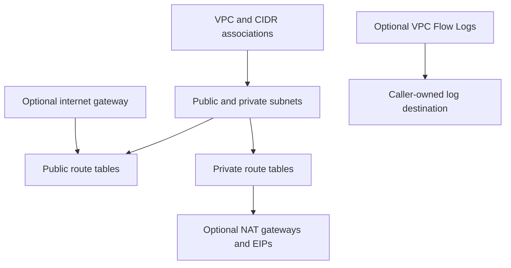

# VPC Module Architecture

The VPC module owns a regional VPC and the subnet routing components declared by its inputs. The calling root owns the AWS provider, address plan, security groups, workload resources, and external destinations such as flow-log storage.

## Resource relationships

Public subnet routes use an internet gateway when enabled. Private IPv4 default routes can use a single NAT gateway or one per Availability Zone; `none` creates no NAT egress. Private IPv6 egress can use an egress-only internet gateway. Routes and subnet associations are derived from stable input map keys.

## Composition and ownership

Pass the resulting VPC, subnet, and route-table IDs to security groups, VPC endpoints, Transit Gateway attachments, and workload modules. Select non-overlapping CIDRs and distribute subnets across the Availability Zones required by the workload. Create application-specific ingress rules in security-group modules.

The module does not create NACL policy, DNS resolver rules, centralized egress inspection, or a Flow Logs destination. Validate routes and address capacity against the full network design before deployment. NAT gateways have hourly and data-processing charges; per-AZ NAT improves failure isolation but costs more than a single gateway.
