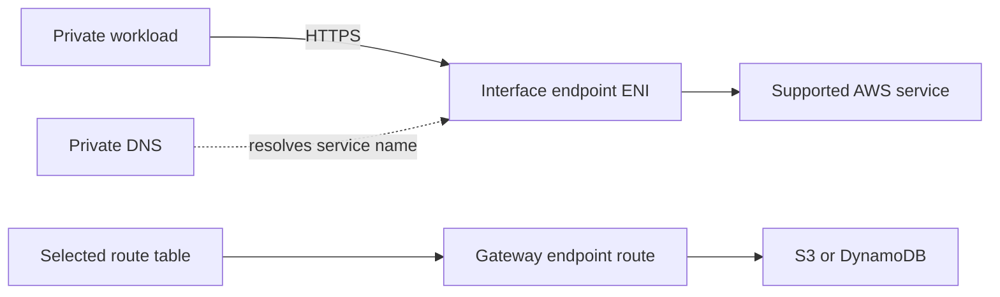

# VPC Endpoints Module Architecture

The module creates endpoints inside an existing VPC. It does not create or modify the VPC, subnets, security groups, route tables, DNS resolver rules, or service permissions.

## Endpoint paths

Interface endpoints place network interfaces in selected private subnets. Private DNS lets standard service names resolve to endpoint addresses when the service and VPC support that configuration. Endpoint security groups must permit traffic from the workload, typically TCP 443. Gateway endpoints add routes to selected route tables for supported services.

## Design and ownership

Use stable endpoint keys and explicitly choose subnet/security-group associations for Interface endpoints and route-table associations for Gateway endpoints. Provide a least-privilege endpoint policy where the service supports one; otherwise the AWS service default may allow broad access subject to identity and resource policies.

Private DNS can conflict with existing private hosted zones or custom DNS forwarding. Check name resolution from the actual workload subnets. Interface endpoints are billed per endpoint-hour and data processed; Gateway endpoints have no endpoint-hour charge. Review current service support and regional pricing before expanding endpoint coverage.
